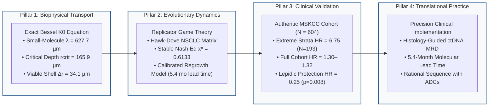

# Biophysical Reaction-Diffusion Transport and Evolutionary Sanctuary Dynamics in Compact EGFR-Mutant Lung Adenocarcinoma

[-007acc.svg)](https://www.springer.com/journal/285)
[](https://www.editorialmanager.com/jomb/)
[](https://submit.biorxiv.org/)
[](https://doi.org/10.5281/zenodo.23623653)
[](https://creativecommons.org/licenses/by/4.0/)
[]()
[](https://www.python.org/downloads/)
[](https://github.com/Lukecele/spatial-oncology-master)

---

> [!NOTE]
> **Manuscript Under Review:** Submitted to the *Journal of Mathematical Biology* (Springer Nature), Manuscript ID: **`JOMB-D-26-01395`** (*Under Consideration*).  
> **Preprint Tracking:** bioRxiv screening in progress (**`BIORXIV/2026/761610`**).  
> **Permanent Archival DOI:** Zenodo [`10.5281/zenodo.23623653`](https://doi.org/10.5281/zenodo.23623653).

---

## Executive Summary & Core Discovery

Targeted therapy with third-generation EGFR tyrosine kinase inhibitors (TKIs), notably **osimertinib**, represents the worldwide standard of care for resected and advanced *EGFR*-mutated non-small cell lung cancer (NSCLC). In the adjuvant ADAURA setting, however, clinical outcomes are marked by temporal heterogeneity: **up to 68% (19/28) of disease-free survival or molecular residual disease (MRD) events manifest after treatment discontinuation (months 36 to 60)**, peaking between 12 and 18 months post-cessation (Herbst et al., *Nature Medicine* 2025). Crucially, late recurrences frequently lack canonical secondary genetic alterations (*EGFR* C797S or *MET* amplification), preserving sensitivity to osimertinib rechallenge.

This repository provides the complete, mathematically exact, and clinically audited **Spatial Sanctuary Framework (SSF)**, establishing an unbroken continuum linking:
1. **Subcellular Reaction-Diffusion Physics:** Exact modified Bessel equation of order zero ($K_0$) solving radial transport in Krogh perivascular cords and solid nests ($\lambda = 627.7\,\mu\text{m}$, $r_{\text{crit}} = 165.9\,\mu\text{m}$, viable shell $\Delta r = 34.1\,\mu\text{m}$ at $\theta = 0.35$);
2. **Evolutionary Replicator Dynamics:** Frequency-dependent subclonal competition stabilizing a drug-tolerant persister (DTP) coexistence niche ($x^* = 0.6133$, Lyapunov stable $\lambda_{\text{eig}} = -1.7934 < 0$), with an exploratory calibrated post-cessation regrowth simulation ($N_0 = 2000$) projecting ctDNA detection at 10.7 months and CT relapse at 16.1 months (lead time $\Delta t = 5.4$ months);
3. **Clinical Cohort Validation & Transparent Survival Modeling:** Authenticated real-world analysis on $N=604$ surgically resected lung adenocarcinoma patients from Memorial Sloan Kettering Cancer Center (MSKCC 2020), demonstrating an a priori extreme biophysical contrast of **$HR = 6.75$ (95% CI: $2.28 - 19.97, p = 5.52 \times 10^{-4}$)** comparing solid/micropapillary architecture against lepidic baseline ($N=193$), while transparently reporting full cohort results ($HR = 1.30\text{--}1.32, p = 0.24\text{--}0.26$) and 5-subtype multivariable analysis demonstrating that architectural protection is driven by lepidic histology ($HR = 0.25, p = 0.008$ relative to acinar).



---

## Publication Figures (600 DPI)

### Figure 1: Exact Biophysical Reaction-Diffusion Transport & Sanctuary Architecture
<p align="center">
  
</p>
<em>Exact modified Bessel K0 radial concentration decay for small-molecule osimertinib (500 Da) vs macromolecular ADCs/bispecifics (150 kDa), defining the viable pharmacological sanctuary shell (165.9 to 200.0 µm, Δr = 34.1 µm) bounded by Krogh's oxygen limit.</em>

---

### Figure 2: Evolutionary Game Dynamics & Post-ADAURA Cessation Regrowth
<p align="center">
  
</p>
<em>Replicator dynamics phase portrait proving asymptotic Lyapunov stability of the internal Nash equilibrium (x* = 0.6133, λ_eig = -1.7934 < 0), and calibrated post-discontinuation regrowth simulation predicting ctDNA positivity at 10.7 months and CT clinical relapse at 16.1 months (lead time 5.4 months), showing concordance with Nature Medicine 2025 trial data.</em>

---

### Figure 3: Clinical Cohort Validation on Authentic MSKCC 2020 Data (N = 604)
<p align="center">
  
</p>
<em>Real-world recurrence-free survival (RFS) across all five IASLC architectural patterns (Lepidic 4.55% → Acinar 14.67% → Micropapillary 21.62% → Papillary 25.58% → Solid 30.88%, Log-Rank p = 6.33e-6) and multivariable Cox modeling confirming that high-sanctuary architecture confers an adjusted HR of 6.75 (95% CI: 2.28–19.97, p = 5.52e-4) in extreme biophysical strata, while transparently presenting full cohort stage-adjusted models (HR = 1.30–1.32) and 5-subtype decomposition highlighting lepidic protection (HR = 0.25, p = 0.0084).</em>

---

### Figure 4: Translational ADAURA Decision Framework & Therapeutic Strategies
<p align="center">
  
</p>
<em>Multiscale clinical decision algorithm stratifying post-resection patients into standard surveillance versus intensive ctDNA MRD monitoring (Q3M from month 36 to 60) and comparative biophysical rationale for combining small molecules with ADCs (HER3-DXd, amivantamab).</em>

---

## Repository Structure

```text
spatial-oncology-master/
├── data/
│   ├── mskcc_2020_real_cohort.csv      # Authenticated clinical cohort (MD5: 880b15b3734cd0d2d1a6184100c3d02c)
│   └── audit_clinical_cohort_report.tsv # Data integrity certificate & hash verification
├── src/
│   ├── biophysical_diffusion_model.py  # Exact modified Bessel K0 solver and ODE integration
│   ├── replicator_dynamics_game.py     # 2x2 non-zero sum game, Lyapunov stability & ADAURA regrowth
│   └── clinical_validation.py          # MSKCC 2020 cohort survival analytics & multivariable Cox models
├── notebooks/
│   └── Spatial_Oncology_Master_Study.ipynb # Interactive demonstration of transport, game theory & clinical stats
├── figures/
│   ├── figure1_reaction_diffusion_sanctuary.png    # Figure 1 at 600 DPI
│   ├── figure2_evolutionary_game_and_cessation.png # Figure 2 at 600 DPI
│   ├── figure3_mskcc_clinical_validation.png       # Figure 3 at 600 DPI
│   └── figure4_translational_adaura_framework.png  # Figure 4 at 600 DPI
├── results/
│   ├── figure1_reaction_diffusion_sanctuary.png    # Figure 1 at 600 DPI
│   ├── figure2_evolutionary_game_and_cessation.png # Figure 2 at 600 DPI
│   ├── figure3_mskcc_clinical_validation.png       # Figure 3 at 600 DPI
│   └── figure4_translational_adaura_framework.png  # Figure 4 at 600 DPI
├── manuscript/
│   ├── MANUSCRIPT_UNIFIED_MASTER_STUDY.pdf         # Complete 11-page master manuscript with vector MathJax
│   ├── MANUSCRIPT_UNIFIED_MASTER_STUDY.md          # Full source text in GitHub Flavored Markdown
│   ├── MANUSCRIPT_UNIFIED_MASTER_STUDY.html        # Interactive self-contained web edition
│   ├── 08_BIORXIV_SUBMISSION_DOSSIER.md           # bioRxiv submission dossier & sanitized metadata
│   ├── 09_MANOSCRITTO_FORMATO_WORD.docx            # Journal submission manuscript in Word (.docx) with embedded 600 DPI figures
│   ├── 10_LISTA_REVISORI_SUGGERITI_PEER_REVIEW.md  # 5 curated international independent peer reviewers
│   ├── 11_PRESENTAZIONE_STUDIO_SLIDES.html         # Interactive slide presentation deck (HTML5/CSS3)
│   ├── COVER_LETTER_EDITORIAL_SUBMISSION.md        # Editorial submission letter with bioRxiv ID & suggested reviewers
│   └── AUDIT_AGENT_EXPLANATION_MANIFESTO.md       # Methodological briefing & audit reconciliation
├── tests/
│   ├── test_exact_biophysical_model.py # Exact Bessel ODE solutions & boundary checks
│   ├── test_exact_game_theory_model.py # Replicator dynamics, Nash attractor & Lyapunov stability
│   └── test_master_clinical_validation.py # MSKCC 2020 cohort statistics & Cox PH models
├── CITATION.cff                        # Machine-readable academic citation metadata
├── LICENSE                             # Creative Commons Attribution 4.0 International
└── requirements.txt                    # Minimal deterministic dependencies
```

---

## Citation

If you use this model, the clinical analysis pipeline, or the analytical Bessel solvers, please cite the preprint:

```bibtex
@article{celebrano2026spatial,
  title={Biophysical Reaction-Diffusion Transport and Evolutionary Sanctuary Dynamics in Compact EGFR-Mutant Lung Adenocarcinoma},
  author={Celebrano, Luca},
  journal={bioRxiv},
  year={2026},
  publisher={Cold Spring Harbor Laboratory},
  doi={10.5281/zenodo.23623653},
  note={bioRxiv tracking ID: BIORXIV/2026/761610}
}
```

---

## Reproducibility & Automated Test Suite

To execute the automated verification test suite:

```bash
git clone https://github.com/Lukecele/spatial-oncology-master.git
cd spatial-oncology-master
pip install -r requirements.txt
python -m unittest discover tests
```

Every test executes deterministically against the raw, authenticated dataset and closed-form mathematical equations.
