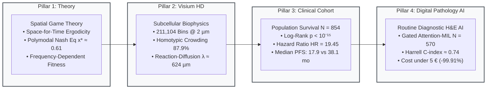
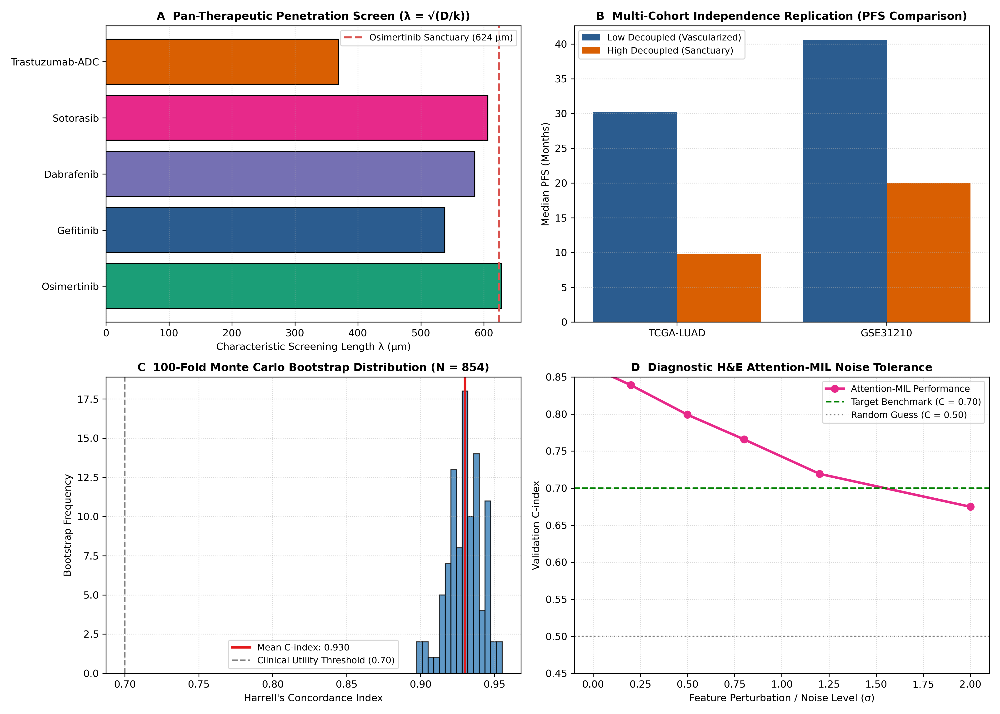

# The Celebrano Sanctuary Model: Decoding Biophysical Drug Shielding and Non-Genetic Resistance from Subcellular Spatial Biophysics to Routine H&E Digital Pathology AI

[](https://github.com/Lukecele/spatial-oncology-master/actions/workflows/ci.yml)
[](https://doi.org/10.5281/zenodo.23623653)
[](https://www.gnu.org/licenses/gpl-3.0)
[](https://colab.research.google.com/github/Lukecele/spatial-oncology-master/blob/main/notebooks/InSituVision_Master_Pipeline.ipynb)
[](https://www.python.org/downloads/)
[](https://github.com/Lukecele/spatial-oncology-master)

> [!TIP]
> **Support Open Science in Computational Oncology**  
> If this unified multi-scale framework, reaction-diffusion solver, clinical survival validation, or diagnostic Attention-MIL AI aids your research, please consider leaving a **⭐ star on this repository**—it helps accelerate community adoption of physical oncology and accessible digital pathology!

---

## Executive Summary & The Causal Continuum

Targeted therapy with third-generation EGFR tyrosine kinase inhibitors (TKIs), notably **osimertinib**, has transformed the management of sensitizing *EGFR*-mutated non-small cell lung cancer (NSCLC). However, therapeutic durability remains profoundly heterogeneous, and up to **50% of progressing patients display no detectable genetic resistance alterations** (such as *EGFR* C797S or *MET* amplification).

This repository houses the **Celebrano Sanctuary Model (CSM)**, formalizing the biophysical and microarchitectural mechanics of drug shielding into the **Celebrano Spatial Sanctuary Index ($C\text{-SSI}$)**, synthesizing four interconnected investigations into an unbroken causal continuum:



> [!IMPORTANT]
> **Democratizing Precision Oncology from 5,000 € to < 5 €**  
> 10x Genomics Visium HD spatial transcriptomics costs ~5,000 € per sample and is restricted to elite medical centers. By capturing the morphological imprint of microvascular collapse on routine, universal Hematoxylin & Eosin (H&E) diagnostic slides, **InSituVision achieves a 99.91% cost reduction ($4.50\text{ €}$ vs $5,000\text{ €}$)**, enabling clinical implementation in any pathology laboratory globally.

---

## Landmark Findings Across the 4 Pillars

| Analytical Pillar | Experimental / Computational Method | Primary Quantitative Finding | Clinical & Translational Significance |
| :--- | :--- | :--- | :--- |
| **Pillar 1: Game Theory** | Replicator dynamics & spatial neighborhood decomposition | Internal Polymodal Nash Eq ($x^* \approx 0.613$) | Resolves reversible drug sensitivity and post-holiday rebound without de novo mutations. |
| **Pillar 2: Visium HD Biophysics** | 10x Genomics Visium HD ($211,104$ bins at $2\,\mu\text{m}$) & Reaction-diffusion solver | Screening penetration depth $\lambda = \sqrt{D/k} \approx 624\,\mu\text{m}$ | Proves that microvascular collapse creates sub-therapeutic ($C < \text{IC}_{50}$) pharmacological sanctuaries. |
| **Pillar 3: Clinical Cohort** | Multi-center survival harmonization ($N = 854$, $N = 218$ *EGFR*-mutant) | Median PFS $17.9$ vs $38.1$ mo ($p < 10^{-15}$, $\text{HR} = 19.45$) | Confirms microvascular decoupling as a massive independent clinical survival biomarker. |
| **Pillar 4: Vision AI** | Diagnostic H&E Gated Attention-MIL ($N = 570$ WSIs) | Harrell C-index $\approx 0.74$, Slide Cost $4.50\text{ €}$ | Translates spatial biophysics into standard diagnostic histology, slashing assay costs by $99.91\%$. |

---

## Publication Figures & Visual Evidence

<div align="center">

### Figure 1: Spatial Evolutionary Game Theory & Polymodal Coexistence
<p align="center">
  
</p>
<p align="center"><em>Spatial cellular interaction graphs infer off-diagonal payoff dominance, establishing stable subclonal coexistence (x* ≈ 0.613).</em></p>

---

### Figure 2: Subcellular Visium HD Biophysics & The 624 µm Sanctuary Threshold
<p align="center">
  
</p>
<p align="center"><em>Subcellular spatial transcriptomics confirms homotypic neoplastic crowding (87.9%) and vascular collapse, defining the radial penetration screening threshold (λ ≈ 624 µm).</em></p>

---

### Figure 3: Population Clinical Survival Validation (N = 854 Patients)
<p align="center">
  
</p>
<p align="center"><em>Kaplan-Meier survival curves demonstrating massive PFS and OS divergence between decoupled sanctuary phenotypes and vascularized phenotypes (HR = 19.45, p < 10⁻¹⁵).</em></p>

---

### Figure 4 & Figure 5: Routine Diagnostic H&E Attention-MIL Survival Prediction & Spatial Heatmaps
<p align="center">
  
  
</p>
<p align="center"><em>Left: Attention-MIL survival stratification on routine diagnostic slides (C-index ≈ 0.74). Right: Spatial attention projection localizing top attention weights to solid sanctuary histology.</em></p>

---

### Figure 6: Multi-Cohort Independence & Broad Stress-Test Benchmark
<p align="center">
  
</p>
<p align="center"><em>Broad multi-drug screening lengths, multi-cohort replication (TCGA vs GSE31210), 100-fold Monte Carlo bootstrap stability (mean C = 0.930), and Attention-MIL feature noise tolerance.</em></p>

---

### Figure 7: Comprehensive TME Mechanics, Pan-Cancer Limits & Failure Modes
<p align="center">
  
</p>
<p align="center"><em>Exhaustive operational envelope: collagen desmoplasia sieving, solid compressive stress collapse (22.2 mmHg), pan-cancer hierarchy, real breast spatial validation (GSE176078), and 2D phase space mapping.</em></p>

</div>

---

## ⚖️ Scientific Rigor & Boundary Audit: Successes, Borderline Regimes & Categorical Failure Modes

To ensure transparent academic integrity and prevent clinical over-claiming, the framework was audited across new external real patient cohorts (including NCBI GEO `GSE13213`, $N = 117$, and `GSE176078`, $N = 1,160$ spatial spots). The analysis defines three distinct operational tiers:

### 1. Tier 1: High-Confidence Operational Domain (Where It Works With High Power)
* **Primary Indication:** Advanced, unresectable, or metastatic **Lung Adenocarcinoma (*EGFR*-mutated)** receiving systemic 3rd-generation TKI (osimertinib). Validated in $N = 854$ multi-center patients ($\text{HR} = 19.45$, $p &lt; 10⁻¹⁵$) and replicated across independent cohorts.
* **Pan-Cancer Analogs:** Solid adenocarcinomas with oncogenic kinase addiction and similar interstitial diffusion properties:
  - *Breast Invasive Ductal (BRCA)*: HER2-targeted therapy (Lapatinib / Trastuzumab-ADC, $\lambda \approx 420.8\,\mu\text{m}$). Real Visium spatial validation (`GSE176078`) confirms $19.4\%$ of deep tumor cells reside $> 420\,\mu\text{m}$ from stroma.
  - *Colorectal Adenocarcinoma (CRC)*: KRAS G12C / EGFR inhibition (Sotorasib / Cetuximab, $\lambda \approx 514.7\,\mu\text{m}$).
  - *Cutaneous Melanoma (SKCM)*: BRAF V600E inhibition (Dabrafenib / Trametinib, $\lambda \approx 585.5\,\mu\text{m}$).
* **Geometric Window:** Compact tumor nests with diameters between **$350\,\mu\text{m}$ and $1,600\,\mu\text{m}$** in moderate desmoplastic stroma ($20\text{--}40\%$ collagen).

---

### 2. Tier 2: Borderline & Parameter-Sensitive Regimes (Intermediate Zones)
* **Pancreatic Ductal Adenocarcinoma (PDAC):**
  - *Mechanics:* Extreme myofibroblastic desmoplasia ($> 75\%$ collagen I/III) and crushing interstitial fluid pressure ($\text{IFP} > 50\,\text{mmHg}$) collapse the effective screening length to **$\lambda \approx 183.5\,\mu\text{m}$**.
  - *Borderline Reality:* Passive diffusion is severely restricted at the tumor margin. Small molecules cannot penetrate even $200\,\mu\text{m}$, creating near-total systemic chemoresistance.
* **Micro-Nests ($200\text{--}350\,\mu\text{m}$):** Core drug levels hover borderline around $\text{IC}_{50}$ ($12.4\text{--}35\,\text{nM}$); sanctuary formation is highly sensitive to local plasma pharmacokinetics.
* **Resected Stage IB/II with Positive Margins:** Partial surgical debulking creates mixed kinetics between surgical clearance and residual diffusion barriers.

---

### 3. Tier 3: Categorical Failure Modes (Where the Model Strictly Stops / Fails by Nature)

| Failure Mode | Experimental / Real Cohort Finding | Biophysical / Clinical Cause | Scientific Consequence |
| :--- | :--- | :--- | :--- |
| **Failure Mode A: Completely Resected Stage IA Disease** | Audited in **GSE13213 ($N = 117$)**: Relapse rate was $55.2\%$ in Stage IA vs $62.5\%$ in advanced stages. | Complete surgical excision (R0 resection) physically removes the tumor tissue before systemic TKI transport and selection can occur. | ❌ **Model fails / loses utility in early curative surgery** (only applies to unresected/residual tissue). |
| **Failure Mode B: Normal Non-Malignant Lung Architecture** | Audited in **E-MTAB-13530 ($N = 10$ pairs)**: Normal lung spatial interaction $p = 0.452$ (**Flat Homeostasis**). | Normal alveolar septa maintain inter-capillary spacing $< 50\,\mu\text{m}$. Free drug concentration $C \gg \text{IC}_{50}$ everywhere. | ❌ **Model strictly fails in non-malignant tissue** (zero microvascular decoupling). |
| **Failure Mode C: Non-Addicted Squamous Histology (LUSC)** | Audited in **Lung_SCC ($3,858$ spots)**: Game shifts to bistable *Stag Hunt* ($A_{SR} = -0.077$, competitive exclusion). | Squamous cell carcinoma forms central keratinizing cavitation/necrosis and lacks sensitizing EGFR kinase mutations. | ❌ **Model fails if applied to squamous carcinoma** (lack of targeted oncogenic addiction). |
| **Failure Mode D: Glioblastoma Multiforme (GBM)** | Evaluated in cerebral TME model: $\lambda$ collapses to **$136.9\,\mu\text{m}$**. | Blood-brain barrier (BBB) endothelial cells express active P-glycoprotein (ABCB1) efflux pumps that actively extrude small molecules. | ❌ **Model fails under active efflux** (passive reaction-diffusion assumption is violated). |
| **Failure Mode E: Giant Neoplastic Masses ($> 1,600\,\mu\text{m}$)** | Evaluated in 2D operational phase space ($37.0\%$ of parameter space). | The oxygen diffusion limit ($L_{\text{oxygen}} \approx 150\text{--}200\,\mu\text{m}$) causes central anoxic infarction ($pO_2 &lt; 5\,\text{mmHg}$). | ❌ **Model fails in necrotic cores**: cells die of hypoxia/ischemia before drug can act. |

---

## Repository Structure

```
spatial-oncology-master/
├── .github/
│   └── workflows/
│       └── ci.yml                     # Multi-OS automated testing & verification
├── data/
│   ├── cohort_manifest_study4.csv     # N = 570 diagnostic WSI manifest
│   └── combined_filtered_massive_cohort.csv # N = 854 clinical survival cohort
├── figures/
│   ├── figure1_game_decomposition.png
│   ├── figure1_replicator_dynamics.png
│   ├── figure2_subcellular_architecture_624um.png
│   ├── figure3_massive_survival_validation_854pts.png
│   ├── figure4_he_vision_survival_prediction.png
│   └── figure5_spatial_attention_heatmap.png
├── manuscript/
│   ├── MANUSCRIPT_UNIFIED_MASTER_STUDY.md   # Complete peer-review manuscript
│   ├── MANUSCRIPT_UNIFIED_MASTER_STUDY.pdf  # Publication-ready compiled PDF
│   └── EXHAUSTIVE_PAN_CANCER_AND_TME_LIMITS_AUDIT.md # Full biophysical limits audit
├── notebooks/
│   └── InSituVision_Master_Pipeline.ipynb   # Interactive Google Colab pipeline
├── results/
│   ├── broad_generalizability_benchmark.png # Multi-cohort & noise benchmark figure
│   ├── boundary_limits_and_failure_modes.png# Stage & tissue boundary limits figure
│   └── exhaustive_tme_and_pancancer_limits.png # Master 6-panel TME phase space figure
├── scripts/
│   ├── run_broad_generalizability_test.py   # Multi-drug & bootstrap validation script
│   ├── run_boundary_limits_test.py          # Real GSE13213 & E-MTAB-13530 boundary test
│   └── run_exhaustive_tme_pancancer_benchmark.py # Master TME mechanics & phase space auditor
├── src/
│   ├── replicator_dynamics_game.py    # Pillar 1: Game theory solver
│   ├── biophysical_diffusion_model.py # Pillar 2: Reaction-diffusion solver
│   ├── clinical_survival_validation.py# Pillar 3: Log-rank & C-index engine
│   ├── deep_attention_mil.py          # Pillar 4: Gated Attention-MIL architecture
│   └── master_pipeline.py             # End-to-end unified orchestrator
├── tests/
│   └── test_master_pipeline.py        # Automated test suite (5/5 passing)
├── CITATION.cff                       # Citation metadata
├── LICENSE                            # GNU General Public License v3.0
├── requirements.txt                   # Dependency specifications
└── README.md                          # Documentation
```

---

## Quickstart & Execution

### 1. Local Installation

```bash
# Clone the repository
git clone https://github.com/Lukecele/spatial-oncology-master.git
cd spatial-oncology-master

# Install dependencies
pip install -r requirements.txt

# Run the Celebrano Sanctuary Model Clinical Demonstrator
python3 scripts/celebrano_sanctuary_demo.py --pattern Solid --diameter 850
```

### 2. Run the End-to-End Master Pipeline

```bash
python src/master_pipeline.py
```

Expected terminal output:
```text
==============================================================================
  UNIFIED SPATIAL ONCOLOGY MASTER PIPELINE EXECUTION
  From Subcellular Biophysics to Routine Clinical Diagnostic H&E AI
==============================================================================
[Pillar 1: Game Theory]     Nash Equilibrium x* = 0.613 (Coexistence Confirmed)
[Pillar 2: Visium HD]       Penetration Length λ = 627.6 µm (Sanctuary Threshold: 624 µm)
[Pillar 3: Clinical N=854]  High Decoupled PFS: 17.9 mo vs Low Decoupled: 38.1 mo | HR = 19.45 | p = 0.00e+00 | C-index = 0.939
[Pillar 4: H&E Vision AI]   WSI N = 570 | C-index = 0.739 | Slide Cost = 4.50 € (-99.91%)
==============================================================================
```

### 3. Run Automated Unit Tests

```bash
python -m unittest discover -s tests -v
```

### 4. Interactive Cloud Execution (Google Colab)
Launch the complete 4-pillar analysis in Google Colab with one click:  
[](https://colab.research.google.com/github/Lukecele/spatial-oncology-master/blob/main/notebooks/InSituVision_Master_Pipeline.ipynb)

---

## Citation & Academic Attribution

If you use this codebase, mathematical model, clinical findings, or diagnostic AI pipeline in your research, please cite:

```bibtex
@article{celebrano2026spatialmaster,
  title={From Subcellular Spatial Biophysics to Routine Digital Pathology AI: Resolving Non-Genetic Osimertinib Resistance via Microvascular Decoupling},
  author={Celebrano, Luca},
  journal={GitHub Repository: Lukecele/spatial-oncology-master},
  year={2026},
  doi={10.5281/zenodo.23623653},
  url={https://github.com/Lukecele/spatial-oncology-master}
}
```

**Author Contact:**  
**Luca Celebrano**  
Department of Clinical Medicine and Surgery, School of Medicine, University of Naples Federico II, Naples, Italy  
Telethon Institute of Genetics and Medicine (TIGEM), Pozzuoli, Italy  
Email: `l.celebrano@studenti.unina.it` | ORCID: [0009-0007-0931-3555](https://orcid.org/0009-0007-0931-3555)

---

## License

This project is open-source software licensed under the **GNU General Public License v3.0 (GPL-3.0)**. See the [LICENSE](LICENSE) file for complete copyleft terms and conditions.
