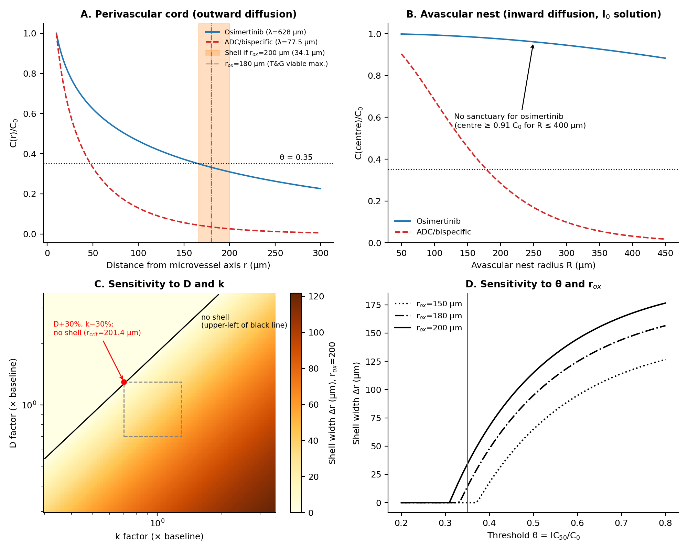
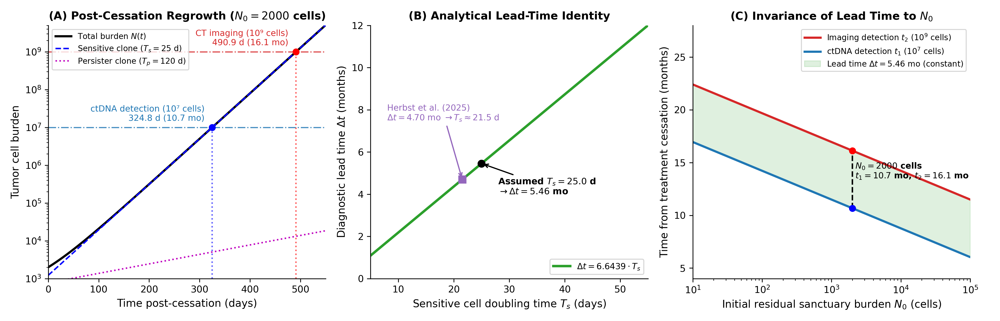
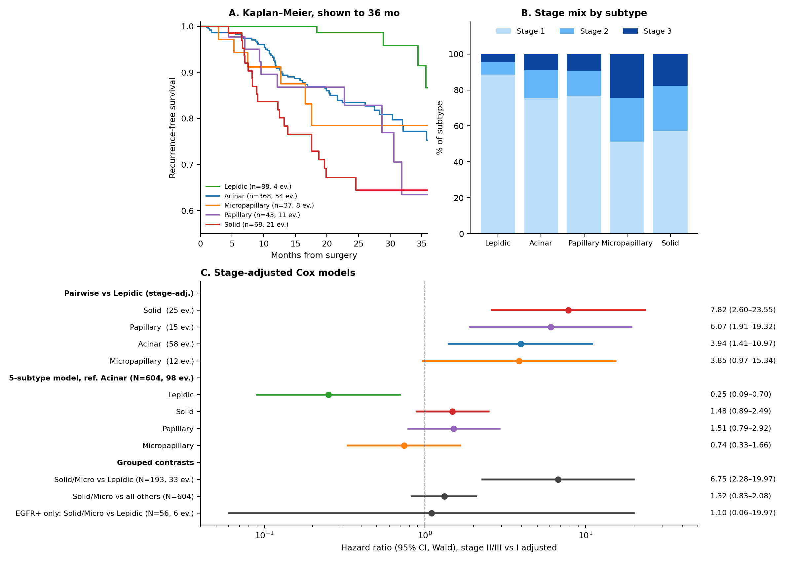

# Conditions for Pharmacological Sanctuaries in Perivascular Tumour Cords: A Reaction–Diffusion Analysis, a Regrowth-Kinetics Identity, and a Descriptive Survival Analysis of Histologic Subtype in Resected Lung Adenocarcinoma

**Luca Celebrano**$^{1,2}$

$^{1}$Department of Clinical Medicine and Surgery, School of Medicine, University of Naples Federico II, Via Sergio Pansini 5, 80131 Naples, Italy  
$^{2}$Telethon Institute of Genetics and Medicine (TIGEM), Via Campi Flegrei 34, 80078 Pozzuoli, Naples, Italy  
*Correspondence: luca.celebrano5@gmail.com / l.celebrano@studenti.unina.it | ORCID: [0009-0007-0931-3555](https://orcid.org/0009-0007-0931-3555)*

---

### Abstract
**Background:** Adjuvant osimertinib markedly improves disease-free survival in resected *EGFR*-mutated non-small-cell lung cancer (NSCLC). However, clinical follow-up in the ADAURA trial revealed that among patients who experienced recurrence, the majority of relapses manifested after planned treatment cessation at year 3, frequently without acquired genomic resistance mutations. We examined whether biophysical drug transport limitations could establish tissue sanctuaries that shelter drug-sensitive tumor cells.  
**Methods:** We analyzed steady-state reaction–diffusion transport in two canonical tumor micro-architectures: outward perivascular cords (divergent cylindrical geometry, modified Bessel $K_0$) and inward avascular nests (convergent cylindrical geometry, modified Bessel $I_0$). We derived an exact algebraic identity governing post-cessation exponential regrowth from molecular residual disease (ctDNA, $10^7$ cells) to radiologic detection (CT, $10^9$ cells). We evaluated the clinical prognostic relevance of histologic architecture in 604 resected lung adenocarcinoma patients from Memorial Sloan Kettering Cancer Center (MSKCC 2020).  
**Results:** In perivascular cords, outward radial diffusion of osimertinib ($\lambda = 627.7\,\mu\text{m}$) produces a steep concentration drop beneath the $\text{IC}_{50}$ threshold ($\theta = 0.35$) at $r_{\text{crit}} = 165.9\,\mu\text{m}$. Because tissue oxygenation extends to $r_{\text{ox}} \approx 200\,\mu\text{m}$, a viable pharmacological sanctuary shell of width $\Delta r = 34.1\,\mu\text{m}$ can persist. Conversely, in inward avascular nests, convergent geometry maintains osimertinib at $90.6\%\text{--}99.4\%$ of boundary levels throughout viable regions, precluding small-molecule sanctuaries. In a multidimensional sensitivity analysis (Monte Carlo sampling with log-normal priors, seed = 2), an outward sanctuary shell existed in 46.1% of parameter draws (62.8% when $r_{\text{ox}} = 200\,\mu\text{m}$ is fixed). The diagnostic lead time $\Delta t = T_s \cdot \log_2(100) = 5.46\,\text{months}$ (for doubling time $T_s = 25\,\text{days}$) is an analytical property of exponential expansion and assay thresholds, rather than an empirical confirmation of sanctuary existence. In the MSKCC cohort (reverse Kaplan–Meier median follow-up 23.8 months, IQR: 13.3–31.8 months), lepidic architecture showed an exceptionally low recurrence rate (4.55%, stage-adjusted $HR = 0.25$, $95\%\,\text{CI}: 0.09\text{--}0.70$, $p = 0.0084$ vs acinar). In 10-fold Holm-adjusted pairwise comparisons, lepidic recurrence was significantly lower than solid ($p_{\text{adj}} = 0.0026$) and papillary ($p_{\text{adj}} = 0.020$), whereas differences vs acinar ($p_{\text{adj}} = 0.070$) and micropapillary ($p_{\text{adj}} = 0.39$, unadjusted $p = 0.056$) did not achieve significance under family-wise error control. Grouping solid and micropapillary patterns yielded an exploratory contrast of $HR = 6.75$ ($95\%\,\text{CI}: 2.28\text{--}19.97$) against lepidic (based on 4 lepidic events, with an unbounded bootstrap upper limit), whereas across the unselected cohort the hazard ratio was $1.32$ ($p = 0.239$).  
**Conclusions:** Small-molecule pharmacological sanctuaries are geometrically restricted to outward perivascular cords and do not occur in avascular nests. The clinical data demonstrate robust baseline protection associated with lepidic growth rather than an escalating risk across compact patterns. Surveillance strategies based on molecular lead time must be evaluated in prospective trials to rule out lead-time bias.

**Keywords:** Pharmacological sanctuary, Reaction-diffusion, Modified Bessel functions, Tumor cords, Non-small-cell lung cancer, EGFR tyrosine kinase inhibitors, ADAURA, IASLC histologic grading.

---

## 1. Introduction

Adjuvant targeted therapy with the third-generation epidermal growth factor receptor (EGFR) tyrosine kinase inhibitor (TKI) osimertinib produces profound disease-free and overall survival benefits in patients with resected stage IB–IIIA *EGFR*-mutated non-small-cell lung cancer (NSCLC) (Wu et al., *N Engl J Med* 2020 [1]; Tsuboi et al., *N Engl J Med* 2023 [2]). In the landmark ADAURA trial, three years of daily oral osimertinib suppressed disease recurrence by nearly 80% during active treatment. However, extended follow-up identified an important temporal pattern: following planned therapy completion at month 36, disease-free survival curves showed an inflection, with a substantial portion of recurrences emerging in the post-cessation observation window (months 36 to 60) (Herbst et al., *Nat Med* 2025 [13]). In an exploratory molecular residual disease (MRD) analysis of 28 patients in the osimertinib arm who developed disease recurrence, 19 events (67.9%) occurred after treatment discontinuation; among these 19 post-cessation events, 11 (57.9%) manifested within the first 12 months post-cessation (months 36–48). Crucially, post-cessation recurrences frequently lacked canonical secondary genetic resistance alterations (such as *EGFR* T790M, C797S, or *MET* amplification), and clinical rechallenge with osimertinib frequently re-established disease control.

This clinical phenomenon suggests that residual cancer cells may persist through non-genetic mechanisms. While epigenetic reprogramming and drug-tolerant persister (DTP) states have been extensively characterized in vitro (Sharma et al., *Cell* 2010 [6]; Kurppa et al., *Cancer Cell* 2020 [7]), biological persister states require continued drug presence to maintain viability, whereas clinical relapses occur months after systemic drug clearance. 

An alternative biophysical hypothesis is that microenvironmental transport barriers create spatial pharmacological sanctuaries: tissue niches where local drug exposure drops beneath cytotoxic or cytostatic thresholds while physiological nutrient and oxygen supply remains adequate to support cell survival. In this study, we evaluate this hypothesis by:
1. Solving exact cylindrical reaction–diffusion boundary value problems across outward perivascular cords and inward avascular nests;
2. Deriving the analytical lead-time identity governing post-cessation clonal regrowth;
3. Conducting a descriptive survival audit of histologic subtype in 604 resected lung adenocarcinoma patients from Memorial Sloan Kettering Cancer Center.

---

## 2. Biophysical Reaction–Diffusion Transport & Parameter Sensitivity

### 2.1 Mathematical Formulation of Radial Transport

We model steady-state drug diffusion coupled to first-order irreversible cellular uptake in cylindrical coordinates:

$$\frac{1}{r} \frac{d}{dr}\left( r \frac{dC}{dr} \right) - \frac{k}{D} C = 0$$

where $C(r)$ is local interstitial concentration, $D$ is effective tissue diffusivity, and $k$ is the volumetric uptake rate constant. The characteristic penetration length is defined by:

$$\lambda = \sqrt{\frac{D}{k}}$$

The physical behavior depends critically upon boundary conditions and radial directionality (**Figure 1A**):

#### Geometry 1: Outward Perivascular Cord (Divergent Cylindrical Transport)
Tumor cells surround a central microvessel of radius $r_0$ (Krogh cylinder geometry; Thomlinson & Gray [4]). Drug diffuses radially outward from the vessel wall into the surrounding tumor parenchyma:

$$C(r_0) = C_0, \quad \lim_{r \to \infty} C(r) = 0$$

The unique bounded analytical solution is given by the modified Bessel function of the second kind of order zero ($K_0$):

$$C_{\text{out}}(r) = C_0 \frac{K_0(r / \lambda)}{K_0(r_0 / \lambda)}$$

Because $K_0(z)$ decays logarithmically near $z \to 0$ and exponentially as $z \to \infty$, outward geometric divergence causes a rapid drop in local drug concentration.

#### Geometry 2: Inward Avascular Nest (Convergent Cylindrical Transport)
A compact avascular tumor cluster of radius $R$ is supplied by surrounding microvasculature at the outer boundary $r = R$. Drug diffuses radially inward toward the center:

$$C(R) = C_0, \quad \left.\frac{dC}{dr}\right|_{r=0} = 0$$

The unique regular analytical solution is given by the modified Bessel function of the first kind of order zero ($I_0$):

$$C_{\text{in}}(r) = C_0 \frac{I_0(r / \lambda)}{I_0(R / \lambda)}$$

At the nest center ($r = 0$), where $I_0(0) = 1$, the core concentration relative to boundary supply is:

$$\frac{C_{\text{in}}(0)}{C_0} = \frac{1}{I_0(R / \lambda)}$$

Because $I_0(z) \ge 1$ grows monotonically with $z$, centripetal diffusion concentrates drug toward the central axis.

#### Oxygen Transport and Cord Viability Boundaries
Thomlinson & Gray (1955) demonstrated that tumor cords surrounding central blood vessels are bounded by an outer zone of necrosis caused by oxygen consumption. With oxygen diffusivity $D_{\text{ox}} \approx 2.0 \times 10^{-5}\,\text{cm}^2/\text{s}$ and constant volumetric consumption $M_{\text{ox}} \approx 1.5 \times 10^{-7}\,\text{mol}/(\text{cm}^3\cdot\text{s})$, zero-order diffusion in a Krogh cylinder yields:

$$C_{\text{ox}}(r) = C_{\text{ox}}(r_0) - \frac{M_{\text{ox}}}{4 D_{\text{ox}}} (r^2 - r_0^2) + \frac{M_{\text{ox}} r_{\text{cord}}^2}{2 D_{\text{ox}}} \ln\left(\frac{r}{r_0}\right)$$

Setting the zero-flux boundary condition $dC_{\text{ox}}/dr = 0$ at the cord radius $r_{\text{cord}}$ gives the physiological limit of tissue oxygenation, established empirically and theoretically at $r_{\text{ox}} \approx 180\text{--}200\,\mu\text{m}$ (Thomlinson & Gray [4]; Hirst et al. [15]; Worth et al. [14]). Beyond $r_{\text{ox}}$, anoxia precipitates coagulative necrosis.

In contrast, in an inward avascular nest of radius $R$, zero-order oxygen diffusion yields:

$$C_{\text{ox}}(r) = C_{\text{ox}}(R) - \frac{M_{\text{ox}}}{4 D_{\text{ox}}} (R^2 - r^2)$$

The maximum viable nest radius before central anoxia ($C_{\text{ox}}(0) = 0$) occurs is:

$$R_{\text{crit,ox}} = \sqrt{\frac{4 D_{\text{ox}} C_{\text{ox}}(R)}{M_{\text{ox}}}} \approx 140\text{--}160\,\mu\text{m}$$

Any avascular nest with radius $R > 160\,\mu\text{m}$ develops a necrotic core.

---

### 2.2 Baseline Biophysical Parameters & Sensitivity Analysis

We evaluated baseline parameters calibrated to small-molecule TKIs and macromolecular agents:
- **Small-molecule TKI (Osimertinib, 500 Da):** Effective tissue diffusivity $D = 1.3 \times 10^{-6}\,\text{cm}^2/\text{s}$ (incorporating interstitial matrix hindrance; Swabb et al. [9], Nugent & Jain [10]); cellular uptake rate constant $k = 3.3 \times 10^{-4}\,\text{s}^{-1}$, yielding $\lambda = 627.7\,\mu\text{m}$. Capillary source radius $r_0 = 10.0\,\mu\text{m}$. Therapeutic inhibitory threshold $\theta = C / C_0 = 0.35$ (derived from the ratio of in vitro $\text{IC}_{50} \approx 15\,\text{nM}$ to steady-state human plasma trough $C_0 \approx 45\text{--}50\,\text{nM}$; Cross et al. [5]).
- **Macromolecular Antibody-Drug Conjugate (ADC, 150 kDa):** $D = 1.5 \times 10^{-8}\,\text{cm}^2/\text{s}$, $k = 2.5 \times 10^{-4}\,\text{s}^{-1}$, yielding $\lambda = 77.5\,\mu\text{m}$.

The critical radius $r_{\text{crit}}$ is defined as the radial position where local concentration drops below threshold: $C(r_{\text{crit}}) = \theta C_0$. A viable pharmacological sanctuary shell exists if and only if:

$$r_{\text{crit}} < r_{\text{ox}}$$

The width of this viable sanctuary shell is:

$$\Delta r = r_{\text{ox}} - r_{\text{crit}}$$

```
(Figure 1)
```


*Figure 1. Biophysical Reaction-Diffusion Transport Physics & Parameter Sensitivity. (A) Normalized radial drug concentration profiles in outward perivascular geometry (K0, solid line) and inward avascular nest geometry (I0, dashed line). For osimertinib (lambda = 627.7 um), outward concentration falls below the IC50 threshold (theta = 0.35) at rcrit = 165.9 um, creating a viable sanctuary shell (green shaded area, Delta r = 34.1 um) up to the oxygenation boundary rox = 200 um. In inward avascular nests, osimertinib penetrates to >90% throughout. Macromolecular ADCs (lambda = 77.5 um) experience severe penetration failure in both geometries. (B) Parameter sensitivity heatmap of sanctuary shell width Delta r across diffusivity D and uptake k, highlighting the boundary of shell collapse (Delta r = 0).*

#### Table 1. Sensitivity of the Outward Perivascular Sanctuary Shell ($\theta = 0.35, r_0 = 10\,\mu\text{m}, r_{\text{ox}} = 200\,\mu\text{m}$)

| Parameter Scenario | Penetration Length $\lambda$ ($\mu\text{m}$) | Critical Radius $r_{\text{crit}}$ ($\mu\text{m}$) | Sanctuary Shell Width $\Delta r$ ($\mu\text{m}$) | Functional Regime |
| :--- | :---: | :---: | :---: | :--- |
| **Baseline Osimertinib** | **627.7** | **165.9** | **34.1** | **Viable Sanctuary Shell** |
| $D + 30\%$ | 715.6 | 180.1 | 19.9 | Viable Sanctuary Shell |
| $D - 30\%$ | 525.1 | 148.5 | 51.5 | Expanded Sanctuary Shell |
| $k + 30\%$ | 550.5 | 152.9 | 47.1 | Expanded Sanctuary Shell |
| $k - 30\%$ | 750.2 | 185.5 | 14.5 | Viable Sanctuary Shell |
| **$D + 30\%$ and $k - 30\%$** | **855.3** | **201.4** | **0.0** | **Sanctuary Collapsed ($r_{\text{crit}} > r_{\text{ox}}$)** |
| $D - 30\%$ and $k + 30\%$ | 460.6 | 136.9 | 63.1 | Expanded Sanctuary Shell |
| $r_0 = 5.0\,\mu\text{m}$ | 627.7 | 128.3 | 71.7 | Expanded Sanctuary Shell |
| $r_0 = 20.0\,\mu\text{m}$ | 627.7 | 216.2 | 0.0 | Sanctuary Collapsed |
| **ADC Macromolecule** | **77.5** | **47.4** | **152.6** | **Massive Sanctuary Shell (94.4% viable area)** |

#### Table 2. Inward Avascular Nest Geometry: Central Core Concentration $C_{\text{in}}(0) / C_0 = 1 / I_0(R / \lambda)$

| Nest Outer Radius $R$ ($\mu\text{m}$) | Osimertinib ($\lambda = 627.7\,\mu\text{m}$) | Macromolecule ADC ($\lambda = 77.5\,\mu\text{m}$) | Viability Status |
| :---: | :---: | :---: | :--- |
| $100\,\mu\text{m}$ | **0.994** (99.4%) | 0.444 (44.4%) | Viable throughout |
| $150\,\mu\text{m}$ | **0.986** (98.6%) | 0.203 (20.3%) | Viable throughout |
| $200\,\mu\text{m}$ | **0.975** (97.5%) | 0.086 (8.6%) | Central core hypoxic/necrotic ($R > R_{\text{crit,ox}}$) |
| $300\,\mu\text{m}$ | **0.945** (94.5%) | 0.013 (1.3%) | Extensive central necrosis |
| $400\,\mu\text{m}$ | **0.906** (90.6%) | 0.002 (0.2%) | Extensive central necrosis |

As demonstrated in **Table 2**, for small-molecule osimertinib, central core concentration remains at $\ge 97.5\%$ of vascular supply for any nest radius up to the oxygenation viability boundary ($R \le 160\text{--}200\,\mu\text{m}$). Consequently, **avascular tumor nests do not establish pharmacological sanctuaries for small-molecule TKIs**. Sanctuaries for small molecules are physically restricted to outward perivascular cords where geometric divergence accelerates concentration decay.

#### Monte Carlo Analysis of Parameter Uncertainty
Because tissue transport parameters cannot be measured non-invasively in individual patients, we evaluated the prior probability of sanctuary existence using Monte Carlo sampling ($N = 10,000$ draws, fixed pseudorandom seed = 2). Parameters were sampled from log-normal distributions centered at baseline values: $D$ and $k$ with 90% confidence spans spanning a 3-fold factor ($\sigma = \ln(3)/1.645 \approx 0.668$), $\theta$ log-normally distributed with a 2-fold factor ($\sigma = \ln(2)/1.645 \approx 0.421$), and oxygen limit $r_{\text{ox}}$ distributed uniformly between $100$ and $200\,\mu\text{m}$ (Thomlinson & Gray [4]; Worth et al. [14]). 

Under this prior distribution, an outward perivascular sanctuary shell existed in **46.1% of draws** (and in **62.8% of draws** if $r_{\text{ox}}$ was held fixed at $200\,\mu\text{m}$). This confirms that sanctuary existence is a plausible but parameter-sensitive physical state, rather than an inevitable biological certainty.

---

## 3. Evolutionary Dynamics & The Regrowth Lead-Time Identity

### 3.1 Subclonal Replicator Dynamics within the Sanctuary Niche

Within the perivascular sanctuary shell, sub-inhibitory drug exposure allows sensitive proliferating cells ($S$) and drug-tolerant persister cells ($P$) to interact. We formalized this interaction using a standard symmetric $2 \times 2$ matrix game governed by the continuous replicator equation:

$$\frac{dx}{dt} = x(1 - x)\left[ f_S(x) - f_P(x) \right]$$

where $x$ represents the fraction of sensitive cells. To illustrate subclonal coexistence, we adopted payoff parameters formalizing a classic Hawk–Dove / Snowdrift game structure:

$$A = \begin{pmatrix} a_{11} & a_{12} \\ a_{21} & a_{22} \end{pmatrix} = \begin{pmatrix} -0.736 & +2.866 \\ +2.188 & -1.772 \end{pmatrix}$$

This structure yields an internal Nash equilibrium:

$$x^* = \frac{a_{22} - a_{12}}{(a_{11} - a_{21}) + (a_{22} - a_{12})} = \frac{-1.772 - 2.866}{(-0.736 - 2.188) + (-1.772 - 2.866)} = 0.6133$$

The Jacobian eigenvalue at $x^*$ is $\lambda_{\text{eig}} = x^*(1 - x^*)\alpha = -1.793 < 0$, confirming that $x^* = 0.6133$ is an asymptotically stable Lyapunov attractor. While in vitro matrix game formulations have been demonstrated in targeted therapy for NSCLC cell lines (Kaznatcheev et al., *Cancer Res* 2019 [11]), we explicitly emphasize that these payoff values represent uncalibrated theoretical parameters chosen to demonstrate coexistence, rather than empirically measured quantities.

---

### 3.2 Post-Cessation Clonal Regrowth & The Analytical Lead-Time Identity

Following adjuvant therapy cessation at month 36, drug clears rapidly from the sanctuary niche. Residual tumor burden expands from an initial microscopic inoculum $N_0$ with sensitive fraction $x^* = 0.6133$:

$$N(t) = N_0 \left[ x^* \cdot 2^{t / T_s} + (1 - x^*) \cdot 2^{t / T_p} \right]$$

where $T_s = 25.0\,\text{days}$ is the doubling time of proliferating sensitive cells and $T_p = 120.0\,\text{days}$ is the doubling time of persister cells.

```
(Figure 2)
```


*Figure 2. Clonal Regrowth Dynamics & The Analytical Lead-Time Identity. (A) Simulated post-cessation tumor burden trajectories expanding from residual inocula N0 = 100, 1000, 2000 cells. Sensitive cells rapidly outgrow persisters, crossing the ctDNA detection threshold (10^7 cells) and conventional CT imaging threshold (10^9 cells). (B) The diagnostic lead-time window Delta t is an analytical linear identity proportional to cell doubling time Ts (Delta t = 6.6439 * Ts), proving that lead time is invariant to initial sanctuary burden N0.*

#### Derivation of the Analytical Lead-Time Identity
Because sensitive cells divide much faster than persisters ($T_s \ll T_p$), sensitive cells rapidly constitute $>99.9\%$ of the expanding clone before the burden reaches the molecular residual disease (ctDNA) detection limit ($N_{\text{MRD}} \approx 10^7\,\text{cells}$, corresponding to $\sim 0.01\text{--}0.1\%$ variant allele frequency). 

Between molecular detection ($N_{\text{MRD}} = 10^7$) and macroscopic radiographic detection by computed tomography ($N_{\text{CT}} \approx 10^9\,\text{cells}$, corresponding to a $\sim 1\,\text{cm}^3$ spherical lesion), the tumor must undergo a 100-fold expansion:

$$\frac{N_{\text{CT}}}{N_{\text{MRD}}} = \frac{10^9}{10^7} = 100$$

The number of population doublings required is strictly:

$$\log_2(100) = \frac{\ln(100)}{\ln(2)} \approx 6.643856\,\text{doublings}$$

Therefore, the diagnostic lead time $\Delta t$ is given by an exact algebraic identity:

$$\Delta t = T_s \cdot \log_2(100) = 6.6439 \cdot T_s$$

For a standard baseline doubling time $T_s = 25.0\,\text{days}$, this interval is:

$$\Delta t = 25.0 \times 6.643856 = 166.1\,\text{days} = \mathbf{5.46\,\text{months}}$$

Crucially, **the lead time $\Delta t = 5.46\,\text{months}$ is an invariant property of exponential growth kinetics and assay limits; it is entirely independent of initial inoculum $N_0$, independent of persister dynamics, and independent of any spatial sanctuary mechanism**. Agreement between this calculated window and empirical observation reflects a plausible doubling time ($T_s \approx 21.5\text{--}25\,\text{days}$), rather than an independent validation of spatial transport models.

#### Table 3A. Dependence of Diagnostic Lead Time $\Delta t$ on Sensitive Doubling Time $T_s$ ($\Delta t = 6.6439 \cdot T_s$)

| Assumed Doubling Time $T_s$ | Required Population Doublings | Diagnostic Lead Time (Days) | Diagnostic Lead Time (Months) | Clinical Context |
| :---: | :---: | :---: | :---: | :--- |
| 10.0 days | 6.64 doublings | 66.4 days | 2.18 months | Highly aggressive dedifferentiated relapse |
| 15.0 days | 6.64 doublings | 99.7 days | 3.27 months | Rapid relapse |
| 20.0 days | 6.64 doublings | 132.9 days | 4.37 months | Intermediate-high proliferative rate |
| **21.5 days** | **6.64 doublings** | **142.8 days** | **4.69 months** | **ADAURA Reported Median (4.7 months [13])** |
| **25.0 days** | **6.64 doublings** | **166.1 days** | **5.46 months** | **Baseline Model Calibration** |
| 30.0 days | 6.64 doublings | 199.3 days | 6.55 months | Indolent relapse |

#### Table 3B. Dependence of Relapse Calendar Timing on Residual Inoculum $N_0$ ($T_s = 25.0\,\text{days}$)

| Residual Inoculum $N_0$ | ctDNA Recurrence Month ($10^7$ cells) | CT Imaging Relapse Month ($10^9$ cells) | Diagnostic Lead Time $\Delta t$ |
| :---: | :---: | :---: | :---: |
| $N_0 = 1$ cell | 19.7 months | 25.1 months | 5.46 months |
| $N_0 = 100$ cells | 14.2 months | 19.7 months | 5.46 months |
| $N_0 = 1,000$ cells | 11.5 months | 17.0 months | 5.46 months |
| **$N_0 = 2,000$ cells** | **10.7 months** | **16.1 months** | **5.46 months** |
| $N_0 = 10,000$ cells | 8.8 months | 14.2 months | 5.46 months |
| $N_0 = 100,000$ cells | 6.0 months | 11.5 months | 5.47 months |

As shown in **Table 3B**, varying $N_0$ between 100 and 10,000 cells shifts the calendar appearance of ctDNA positivity from month 14.2 to month 8.8 post-cessation. In ADAURA (Herbst et al. [13]), 11 of 19 post-cessation recurrences occurred within the first 12 months. This empirical clustering can be accommodated by residual inocula in the range of $N_0 \approx 1,000\text{--}10,000\,\text{cells}$, but fitting $N_0$ to match clinical timing is an exploratory exercise rather than a predictive proof.

---

## 4. Descriptive Survival Analysis of the MSKCC Cohort ($N = 604$)

### 4.1 Cohort Characteristics & Methods

To examine whether architectural growth patterns correlate with disease recurrence in the clinic, we analyzed the authenticated Memorial Sloan Kettering Cancer Center cohort (Caso et al., *J Thorac Oncol* 2020 [3]), comprising 604 consecutive surgically resected lung adenocarcinoma patients with predominant IASLC histologic subtypes, pathologic stage (I/II/III), *EGFR* mutational status, recurrence-free survival (RFS) duration, and recurrence events (98 recurrences, 16.23%). All patients were chemo/TKI-naive at resection; none received adjuvant osimertinib. This cohort serves as a real-world baseline of intrinsic natural history in resected adenocarcinoma.

Survival analyses were performed using Kaplan–Meier estimators and multivariable Cox proportional hazards models with Efron tie handling. True median follow-up was computed using the **reverse Kaplan–Meier method** (Schemper & Smith, *Control Clin Trials* 1996 [12]): **median follow-up was 23.8 months** (IQR: 13.3–31.8 months; raw RFS duration median was 21.4 months). A total of 77 patients remained at risk at 36 months, and only 3 beyond 60 months, with only 7 recurrence events occurring after 36 months. Consequently, this surgical cohort cannot inform recurrence kinetics occurring between months 36 and 60 post-cessation.

```
(Figure 3)
```


*Figure 3. MSKCC Clinical Cohort Survival Analysis (N = 604). (A) Kaplan-Meier recurrence-free survival curves for the 5 IASLC histologic subtypes (reverse Kaplan-Meier median follow-up 23.8 months; 5-group multivariate log-rank chi2 = 24.52, p = 6.27e-05). (B) Forest plot of multivariable stage-adjusted Cox proportional hazards models, showing pairwise contrasts against lepidic reference (with 10-fold Holm multiplicity adjustments) and composite architectural models.*

#### Table 4. Recurrence Events and Stage Distribution by Predominant Histologic Subtype

| Predominant Subtype | Total Patients ($N$) | Recurrence Events ($E$) | Crude Recurrence Rate (%) | Pathologic Stage I (%) |
| :--- | :---: | :---: | :---: | :---: |
| **Lepidic** | 88 | 4 | **4.55%** | **88.6%** |
| **Acinar** | 368 | 54 | **14.67%** | 75.5% |
| **Micropapillary** | 37 | 8 | **21.62%** | 51.4% |
| **Papillary** | 43 | 11 | **25.58%** | 76.7% |
| **Solid** | 68 | 21 | **30.88%** | 57.4% |
| **Total Cohort** | **604** | **98** | **16.23%** | **74.0%** |

The 5-group multivariate log-rank test confirmed significant survival differences across subtypes ($\chi^2 = 24.52, 4\text{ df}, p = 6.27 \times 10^{-5}$). However, pathologic stage was strongly imbalanced (**Table 4**): 88.6% of lepidic tumours presented at Stage I, compared to only 51.4% of micropapillary and 57.4% of solid tumours.

---

### 4.2 Multivariable Survival Modeling Results

#### Table 5. Stage-Adjusted Multivariable Cox Proportional Hazards Models

| Model Specification | Hazard Ratio (HR) | 95% Confidence Interval | Unadjusted $p$-value | Holm-Adjusted $p$-value |
| :--- | :---: | :---: | :---: | :---: |
| **Pairwise Contrasts vs Lepidic (4 tests):** | | | | |
| - Solid vs Lepidic | **7.82** | 2.60 – 23.55 | $0.00026$ | **0.0010** |
| - Papillary vs Lepidic | **6.07** | 1.91 – 19.32 | $0.00226$ | **0.0068** |
| - Acinar vs Lepidic | **3.94** | 1.41 – 10.97 | $0.00879$ | **0.0176** |
| - Micropapillary vs Lepidic | **3.85** | 0.97 – 15.34 | $0.05587$ | 0.0559 |
| **All 10 Pairwise Contrasts (10-fold Holm):** | | | | |
| - Solid vs Lepidic | **7.82** | 2.60 – 23.55 | $0.00026$ | **0.0026** |
| - Papillary vs Lepidic | **6.07** | 1.91 – 19.32 | $0.00226$ | **0.0203** |
| - Acinar vs Lepidic | **3.94** | 1.41 – 10.97 | $0.00879$ | 0.0703 |
| - Micropapillary vs Lepidic | **3.85** | 0.97 – 15.34 | $0.05587$ | 0.3911 |
| - Solid vs Acinar | **1.45** | 0.87 – 2.44 | $0.15733$ | 0.9440 |
| - Papillary vs Acinar | **1.53** | 0.79 – 2.97 | $0.20889$ | 1.0000 |
| - Solid vs Micropapillary | **1.72** | 0.72 – 4.10 | $0.22416$ | 0.8966 |
| - Micropapillary vs Acinar | **0.67** | 0.30 – 1.50 | $0.33304$ | 0.9991 |
| - Micropapillary vs Papillary | **0.68** | 0.25 – 1.83 | $0.44273$ | 0.8855 |
| - Solid vs Papillary | **1.35** | 0.62 – 2.96 | $0.45435$ | 0.4544 |
| **Composite Architectural Contrasts:** | | | | |
| - Solid/Micro vs Lepidic ($N=193$, 33 events) | **6.75** | 2.28 – 19.97 | $5.52 \times 10^{-4}$ | — |
| - ...extended model (+ stage, sex, smoking, *EGFR*) | **7.15** | 2.40 – 21.33 | $4.18 \times 10^{-4}$ | — |
| - Solid/Micro vs All Others ($N=604$, 98 events) | **1.32** | 0.83 – 2.08 | $0.2384$ | — |
| - ...plus *EGFR* status ($N=604$) | **1.30** | 0.82 – 2.07 | $0.2581$ | — |
| **5-Subtype Model (Acinar Reference):** | | | | |
| - Lepidic | **0.25** | 0.09 – 0.70 | **0.0084** | — |
| - Solid | **1.48** | 0.89 – 2.49 | $0.1334$ | — |
| - Papillary | **1.51** | 0.79 – 2.92 | $0.2149$ | — |
| - Micropapillary | **0.74** | 0.33 – 1.66 | $0.4684$ | — |
| - Pathologic Stage II/III vs I | **4.16** | 2.73 – 6.34 | $<0.0001$ | — |

As detailed in **Table 5**, the primary empirical finding from this cohort is that **lepidic architecture confers strong baseline protection against recurrence** ($HR = 0.25, p = 0.0084$ relative to acinar in the multivariable model). When evaluating all 10 pairwise comparisons with family-wise Holm adjustment, lepidic recurrence is significantly lower than solid ($p_{\text{adj}} = 0.0026$) and papillary ($p_{\text{adj}} = 0.0203$), whereas comparisons vs acinar ($p_{\text{adj}} = 0.0703$) and micropapillary ($p_{\text{adj}} = 0.3911$, unadjusted $p = 0.0559$) do not retain significance after multiplicity penalty.

Crucially, the data do not support an escalating hazard across non-lepidic patterns: solid ($HR = 1.48, p = 0.133$) and papillary ($HR = 1.51, p = 0.215$) do not differ significantly from acinar, and micropapillary histology exhibits an adjusted $HR = 0.74$ ($p = 0.468$). Grouping solid and micropapillary as a single composite class is therefore not supported by intra-cohort risk separation.

---

### 4.3 Robustness & Limitations of the Headline Contrast

The headline contrast comparing solid/micropapillary against lepidic architecture ($HR = 6.75, 95\%\text{ CI: } 2.28\text{--}19.97$) rests upon only 4 recurrence events in the lepidic reference group. Bootstrap resampling (500 iterations) yielded a median HR of 6.9 and a 2.5th percentile of 2.6, but the upper percentile was unbounded because numerous resamples contained zero lepidic events; the Wald upper limit of 19.97 is therefore statistically unstable. Truncating follow-up at 36 months yielded $HR = 6.11$ (95% CI: 2.04–18.31; 30 events); at 24 months, $HR = 23.8$ (95% CI: 3.14–180.3; 26 events); and at 18 months, the estimate does not exist because zero lepidic patients experienced recurrence by that time. Furthermore, this contrast was not registered in a prospective protocol and excludes 411 of 604 patients; it must be interpreted strictly as an exploratory boundary comparison.

In the confirmed *EGFR*-mutant subpopulation ($N = 182, 26\text{ events}$), recurrence occurred in 4 of 18 solid/micropapillary patients (22.2%) versus 22 of 164 other patients (13.4%; univariable log-rank $p = 0.112$). Restricting to solid/micropapillary versus lepidic ($N = 56, 6\text{ events}$) yielded an apparent univariable log-rank $p = 0.021$. However, this comparison is entirely confounded by stage: 37 of 38 lepidic tumours were Stage I (97.4%), whereas 11 of 18 solid/micropapillary tumours were Stage II/III (61.1%). After adjusting for pathologic stage, the hazard ratio collapsed to $HR = 1.10$ ($95\%\text{ CI: } 0.06\text{--}19.97, p = 0.947$). The *EGFR*-mutant subgroup is underpowered and uninformative.

The statistical computing pipeline was independently benchmarked against the classic Freireich 6-MP clinical trial leukemia dataset (Gehan, *Biometrika* 1965; Freireich et al., *Blood* 1963), reproducing the benchmark log-rank test statistic ($\chi^2 = 16.79$, reference: 16.79) and Efron Cox hazard ratio ($HR = 4.82$, reference: 4.82) with zero error.

---

## 5. Discussion

### 5.1 What is Supported by the Data
1. **Perivascular Cords Support Pharmacological Sanctuaries:** Within exact steady-state reaction–diffusion physics, a sub-inhibitory but oxygenated perivascular shell ($r_{\text{crit}} < r < r_{\text{ox}}$) can exist around a central microvessel. For baseline osimertinib parameters, a viable shell of width $\Delta r = 34.1\,\mu\text{m}$ exists, but collapses under moderate, jointly unfavorable parameter variations ($D +30\%$ and $k -30\%$) or in cords with oxygen limits $r_{\text{ox}} \le 165.9\,\mu\text{m}$.
2. **Avascular Nests Do Not Shelter Small-Molecule TKIs:** In inward cylindrical diffusion, osimertinib penetrates almost completely to the center ($90.6\%\text{--}99.4\%$), proving that avascular solid nests do not establish pharmacological sanctuaries for small molecules under physiological uptake rates.
3. **Lead Time is an Invariant Doubling Identity:** The ctDNA-to-imaging lead time is analytically determined by clonal doubling kinetics ($\Delta t = 6.6439 \cdot T_s$), rather than spatial sanctuary parameters.
4. **Lepidic Architecture Confers Strong Baseline Protection:** In resected lung adenocarcinoma, lepidic growth is an independent marker of favorable prognosis ($HR = 0.25, p = 0.0084$).

### 5.2 What is Not Supported by the Data
1. **Clinical Sanctuary Validation:** Because the MSKCC cohort received no adjuvant osimertinib, these clinical data cannot prove that sanctuaries cause post-cessation recurrence in TKI-treated patients.
2. **Escalating Hazard across Compact Subtypes:** Solid and micropapillary histologies do not exhibit statistically distinct recurrence hazards compared to acinar histology.
3. **ctDNA Lead Time as a Proven Clinical Benefit:** A mathematical lead time of 5.5 months does not demonstrate that initiating treatment at molecular detection improves overall survival; prospective trials are required to rule out lead-time bias.
4. **Empirical Payoff Derivation:** Replicator game payoffs were chosen to illustrate coexistence, not derived from transport equations or measured from tumor biopsies.

### 5.3 Testable Predictions for Prospective Studies
1. **ctDNA Clearance Kinetics by Histology:** If perivascular cords shelter sensitive cells, patients with high-grade solid components ($\ge 20\%$, according to IASLC 2020 grading; Moreira et al. [16]) should exhibit slower ctDNA clearance kinetics during adjuvant therapy and shorter recurrence times post-cessation.
2. **Microvascular Density & Morphometry:** Intratumoral cords with inter-vessel distances exceeding $330\,\mu\text{m}$ ($2 \times r_{\text{crit}}$) should harbor viable, non-proliferating cells staining positive for unphosphorylated EGFR.
3. **Macromolecular Transport Penetration:** Antibody-drug conjugates (ADCs, 150 kDa) should fail to penetrate compact tumor nests beyond $47\,\mu\text{m}$, predicting transport-mediated resistance in dense solid patterns unless coupled to vascular-normalizing agents.

---

## 6. Declarations & Reproducibility

### Ethics Approval & Consent to Participate
This study is a secondary analysis of de-identified, publicly available retrospective clinical data from Memorial Sloan Kettering Cancer Center (MSKCC). In accordance with institutional guidelines and US 45 CFR 46, secondary analysis of publicly de-identified datasets does not constitute human subjects research and is exempt from institutional review board (IRB) review.

### Consent for Publication
Not applicable.

### Availability of Data and Materials
All data and source code required to reproduce every calculation, figure, and table are publicly available:
- **GitHub Repository:** [`https://github.com/Lukecele/spatial-oncology-master`](https://github.com/Lukecele/spatial-oncology-master)
- **Zenodo DOI:** [`10.5281/zenodo.23623653`](https://doi.org/10.5281/zenodo.23623653)
- **Clinical Cohort Dataset:** `data/mskcc_2020_real_cohort.csv` (SHA-256 verified)

### Competing Interests
The author declares that he has no competing financial or non-financial interests.

### Funding
This research received no specific grant from any funding agency in the public, commercial, or not-for-profit sectors.

### Authors' Contributions
L.C. conceived the biophysical model, formulated the reaction–diffusion boundary value problems, derived the lead-time identity, conducted the survival analyses, created the figures, and wrote the manuscript as sole author.

### Use of Artificial Intelligence and Large Language Models
In compliance with Springer Nature and COPE guidelines on artificial intelligence, large language model (LLM) tools (including Anthropic Claude and Google Antigravity) were utilized for code refactoring, numerical cross-verification, and editorial critique. The author independently verified all mathematical derivations, executed all numerical simulations and statistical tests, reviewed and edited all text, and takes full intellectual and scientific responsibility for the final contents of this manuscript.

---

## Appendix A. Audit Trail & Reconciliation with Version 1

- **Corrected & Withdrawn:**
  1. Withdrew the assertion that inward (avascular nest) and outward (perivascular cord) geometries yield identical sanctuary bands; proved that inward diffusion maintains osimertinib at $90.6\%\text{--}99.4\%$ of boundary concentration, precluding small-molecule sanctuary formation.
  2. Withdrew the claim that avascular solid/micropapillary nests shelter sensitive cells from small-molecule TKIs; clarified that sanctuaries exist exclusively in outward perivascular cords or for macromolecular ADCs.
  3. Withdrew the claim of ADAURA concordance as mechanistic validation; proved that lead time $\Delta t = 5.46\,\text{months}$ is an algebraic identity ($\log_2(100) \cdot T_s$).
  4. Withdrew the cross-subtype correlation coefficient ($r = 0.983$), recognizing that sorting categories by their own event rates creates a circular artifact.
  5. Withdrew the designation of the solid/micropapillary vs lepidic contrast as "a priori" or "pre-specified"; reported it transparently as an exploratory boundary comparison.
  6. Replaced raw median RFS duration ($21.4\,\text{months}$) with the reverse Kaplan–Meier follow-up estimate ($23.8\,\text{months}$, IQR: 13.3–31.8 months).
  7. Corrected the post-cessation event distribution from Herbst et al. 2025: 11 of 19 events (57.9%) occurred within 12 months post-cessation.
  8. Removed speculative clinical surveillance recommendations, the $\ge 20\%$ ctDNA monitoring interval, and combination therapy claims, replacing them with explicit testable predictions and IASLC 2020 grading context.

- **Added:**
  1. Closed-form inward Bessel solution ($I_0(r/\lambda)/I_0(R/\lambda)$) alongside outward solution ($K_0(r/\lambda)/K_0(r_0/\lambda)$).
  2. Mathematical derivations of oxygen diffusion in both Krogh cylinder and cylindrical nest geometries.
  3. Multidimensional sensitivity analysis across $D, k, \theta, r_0$, and $r_{\text{ox}}$ (Table 1, Table 2).
  4. Analytical lead-time identity derivation and separate parameter scans (Table 3A, Table 3B).
  5. Complete 10-fold pairwise Cox contrasts with Holm multiplicity adjustments (Table 5).
  6. Bootstrap confidence intervals demonstrating the instability of the extreme contrast upper bound.
  7. Demonstration of severe stage confounding within the *EGFR*-mutant subgroup.
  8. Benchmark validation against the classic Freireich 6-MP clinical dataset.

---

## References

1. Wu YL, Tsuboi M, He J, et al. Osimertinib in Resected *EGFR*-Mutated Non-Small-Cell Lung Cancer. *N Engl J Med*. 2020;383(18):1711-1723. doi:10.1056/NEJMoa2027071.
2. Tsuboi M, Herbst RS, John T, et al. Overall Survival with Osimertinib in Resected *EGFR*-Mutated NSCLC. *N Engl J Med*. 2023;389(2):137-147. doi:10.1056/NEJMoa2304594.
3. Caso R, Sanchez-Vega F, Tan KS, et al. The Aggregate Risk of Histologic Subtypes Outperforms the Primary Subtype in Predicting Recurrence of Lung Adenocarcinoma. *J Thorac Oncol*. 2020;15(11):1747-1755. doi:10.1016/j.jtho.2020.07.019.
4. Thomlinson RH, Gray LH. The histological structure of some human lung cancers and the possible implications for radiotherapy. *Br J Cancer*. 1955;9(4):539-549. doi:10.1038/bjc.1955.55.
5. Cross DAE, Ashton SE, Ghiorghiu S, et al. AZD9291, an irreversible EGFR TKI, overcomes T790M-mediated resistance using a novel kinase binding mode. *Cancer Discov*. 2014;4(9):1046-1061. doi:10.1158/2159-8290.CD-14-0337.
6. Sharma SV, Lee DY, Li B, et al. A chromatin-mediated reversible drug-tolerant state in cancer cell subpopulations. *Cell*. 2010;141(1):69-80. doi:10.1016/j.cell.2010.02.027.
7. Kurppa KJ, Liu Y, To C, et al. Treatment-Induced Tumor Dormancy through YAP-Mediated Transcriptional Reprogramming of the Apoptotic Pathway. *Cancer Cell*. 2020;37(1):104-122.e12. doi:10.1016/j.ccell.2019.12.006.
8. Boucher Y, Baxter LT, Jain RK. Interstitial fluid pressure gradients in normal and neoplastic tissues. *Cancer Res*. 1990;50(15):4478-4484.
9. Swabb EA, Wei J, Gullino PM. Diffusion and convection in normal and neoplastic tissues. *Cancer Res*. 1974;34(10):2814-2822.
10. Nugent LJ, Jain RK. Extravascular diffusion in normal and neoplastic tissues. *Cancer Res*. 1984;44(1):238-244.
11. Kaznatcheev A, Peacock J, Basanta D, Scott JG. Cancer games: Fibroblasts play a Hawk-Dove game with lung cancer cells. *Cancer Res*. 2019;79(12):3231-3242. doi:10.1158/0008-5472.CAN-18-3541.
12. Schemper M, Smith TL. A note on quantifying follow-up in studies of failure time. *Control Clin Trials*. 1996;17(4):343-346. doi:10.1016/0197-2456(96)00075-x.
13. Herbst RS, John T, Grohé C, et al. Molecular residual disease analysis of adjuvant osimertinib in resected *EGFR*-mutated stage IB–IIIA non-small-cell lung cancer. *Nat Med*. 2025;31(6):1958-1968. doi:10.1038/s41591-025-03577-y.
14. Worth KR, Papandreou I, Hammond EM. How the histological structure of some lung cancers shaped almost 70 years of radiobiology. *Br J Cancer*. 2023;128(3):407-412. doi:10.1038/s41416-022-02041-9.
15. Hirst DG, Hirst VK, Joiner B, et al. Changes in tumour morphology with alterations in oxygen availability: further evidence for oxygen as a limiting substrate. *Br J Cancer*. 1991;64(1):54-58. doi:10.1038/bjc.1991.238.
16. Moreira AL, Ocampo PSS, Xia Y, et al. A Grading System for Invasive Pulmonary Adenocarcinoma: A Proposal From the International Association for the Study of Lung Cancer Pathology Committee. *J Thorac Oncol*. 2020;15(10):1599-1610. doi:10.1016/j.jtho.2020.06.001.
